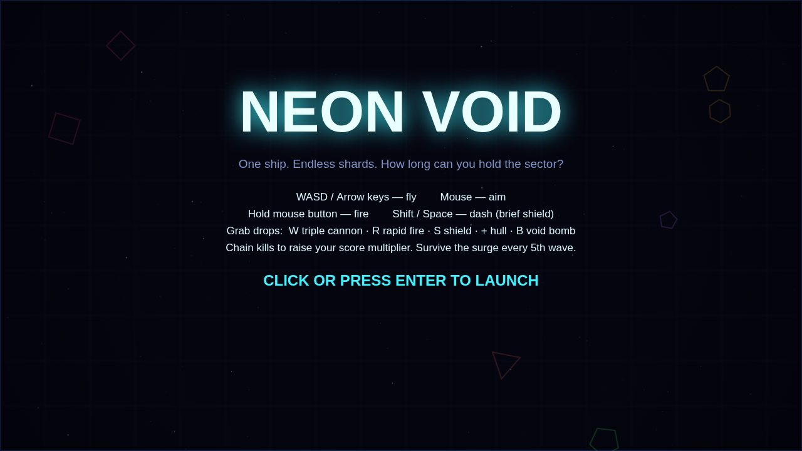
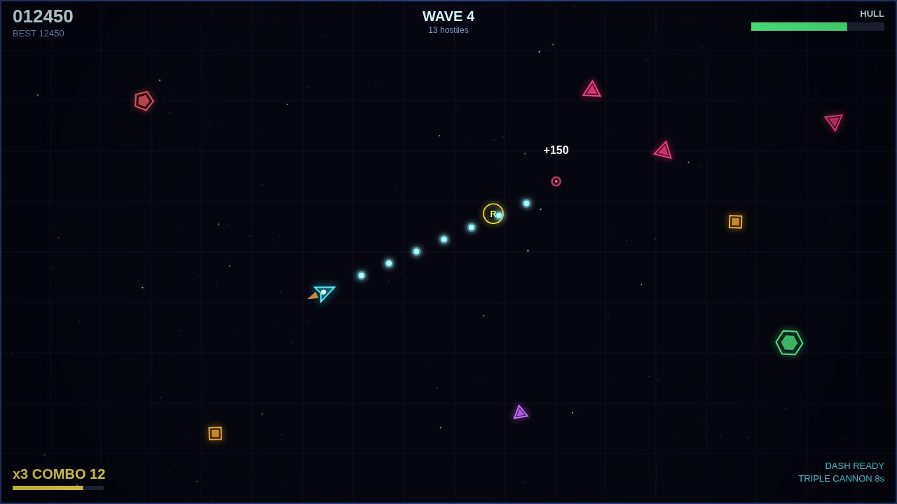
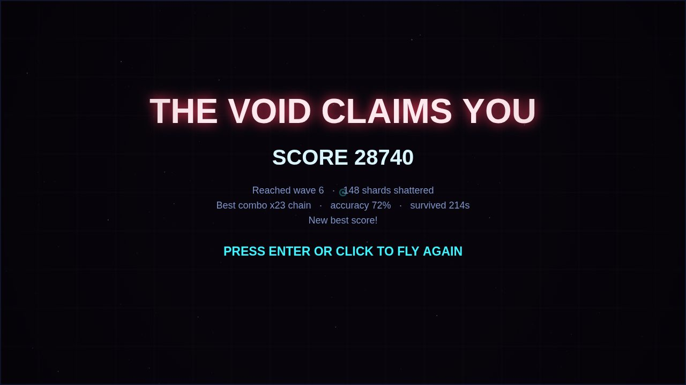

[](https://make.fun/bounty/best-game-01?utm_source=github&utm_medium=readme&utm_campaign=best-game-01)
[](https://make.fun/bounty/best-game-01/leaderboard?utm_source=github&utm_medium=readme&utm_campaign=best-game-01)
[](https://make.fun/bounty/best-game-01?utm_source=github&utm_medium=readme&utm_campaign=best-game-01)

# Neon Void

**One ship. Endless shards. How long can you hold the sector?**

Neon Void is an original neon arena survival shooter that runs entirely in a
desktop browser from its own static files — no build step, no assets, no network.
You pilot the last starfighter in a collapsing sector. Geometric void shards pour
in from the edges in escalating waves; shatter them, chain kills into score
multipliers, grab weapon drops, and survive the surge every fifth wave.



## How to play

| Input | Action |
| --- | --- |
| **WASD / Arrow keys** | Fly |
| **Mouse** | Aim |
| **Hold left mouse button** (or `J`) | Fire |
| **Shift / Space** (or `K`) | Dash — a short invulnerable burst |
| **P / Esc** | Pause / resume |
| **Enter / Click** | Start, and restart after game over |

- **Goal:** score as much as you can before your hull reaches zero. There is no
  final wave — the void always wins eventually; the score is the trophy.
- **Combo:** every kill starts a 2.2-second chain window. Keep killing to grow
  the chain: every 5 chain kills raise the score multiplier by 1, up to **x8**.
  Taking a hit resets the chain.
- **Drops:** destroyed shards sometimes drop a pickup that drifts toward you:
  `W` triple cannon (12 s), `R` rapid fire (10 s), `S` shield (blocks one hit),
  `+` hull repair (+30), and the rare `B` void bomb, which clears the screen.
- **Waves:** each wave is bigger and faster than the last. New shard types join
  over time — see below — and every 5th wave is a surge. Clearing a wave pays a
  bonus of 100 × wave number.



## The shards

- **Chaser** (pink triangle) — flies straight at you. Weak, but never alone.
- **Weaver** (amber diamond) — sways side to side as it closes in. Wave 2+.
- **Darter** (violet triangle) — pauses, flashes, then lunges. Wave 3+.
- **Splitter** (green hexagon) — bursts into three fast minis when destroyed. Wave 4+.
- **Spitter** (red pentagon) — keeps its distance and lobs plasma orbs. Wave 5+.
- **Tank** (magenta pentagon) — slow, heavily armoured, hits hard. Wave 6+.

## Game over

When the hull fails, the run ends with your score, wave reached, shards
shattered, best combo, accuracy and survival time — and one key press flies
again. Your best score is kept in the browser.



## Run it locally

Requires Node 22 (any static file server works just as well):

```sh
node serve.ts            # serves game/ at http://localhost:8080
```

Then open <http://localhost:8080> in desktop Chrome. Everything — graphics,
particles and the synthesized WebAudio sound effects and music — is generated
by the code in `game/`; the game works fully offline.

Deterministic screenshot scenes used for the pictures above:
`http://localhost:8080/?shot=start`, `?shot=play`, `?shot=end` (add `&seed=n`).

## Hand it in (make.fun)

```sh
mkdir -p out && MAKEFUN_OUTPUT_DIR=out node main.ts
```

`main.ts` copies `game/` and `screenshots/` to the output directory and writes
`dossier.json` with the vendored `buildDossier` library, exactly as the
best-game-01 bounty requires.

## Layout

- `game/index.html` — the page and its styles
- `game/src/config.js` — tuning constants and the palette
- `game/src/random.js` — the seeded RNG (live chaos, deterministic screenshots)
- `game/src/audio.js` — WebAudio-synthesized effects and music
- `game/src/input.js` — keyboard and mouse state
- `game/src/particles.js` — sparks, shockwave rings and floating score text
- `game/src/world.js` — the simulation: ship, shards, bullets, drops, waves
- `game/src/render.js` — canvas painting: arena, HUD, title and end screens
- `game/src/shots.js` — the staged screenshot scenes
- `game/src/main.js` — the frame loop and the game-state machine
- `main.ts` — the entry program that hands the game in
- `serve.ts` — the local development server
- `vendor/makefun-game.ts` — make.fun's dossier library, vendored unchanged

Licensed under the MIT License (see `LICENSE`).
